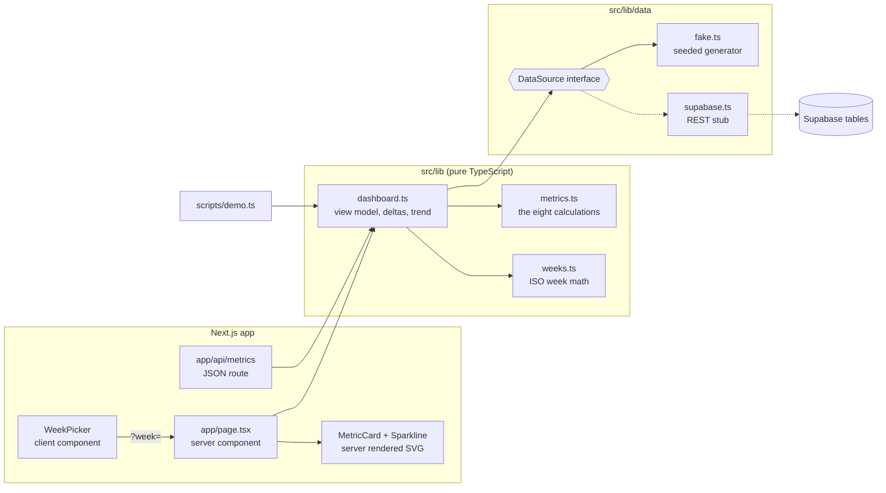

# owner-dashboard

**Live demo:** https://owner-dashboard-chi-nine.vercel.app (seeded fake data, no login)

A service business owner needs eight numbers every Monday, and they usually live in five different tools.
This is one page that computes them from raw records, shows the trend, and lets the owner step back week by week.

## What it does

A Next.js (App Router) dashboard with one card per metric. Each card shows the value for the selected week, the change against the previous week (coloured by whether that change is good news), a one line breakdown and a twelve week sparkline.

| Metric | Definition used here |
| --- | --- |
| Leads | Leads created during the week |
| Speed to lead | Median minutes from lead created to first response, for leads created during the week |
| Booked | Estimate visits put on the calendar during the week |
| Close rate | Won divided by decided (won plus lost) for estimates decided during the week |
| Revenue | Invoiced amount of jobs completed during the week |
| Job margin | (Revenue minus cost) over revenue across jobs completed during the week, revenue weighted |
| Open change orders | Change orders requested but not approved or declined as of the end of the week |
| Review rate | Reviews received divided by review requests sent during the week |

Other things in the box:

- A week picker (previous, next, dropdown). The selected ISO week lives in the URL as `?week=2026-W40`, so a view can be bookmarked or shared.
- A JSON endpoint, `GET /api/metrics?week=2026-W40&trend=12`, that returns the same view model the page renders.
- A data adapter interface with two implementations: a seeded fake source that is fully deterministic, and a documented Supabase stub.
- Metric math in pure functions with no I/O, covered by unit tests.

## Architecture



The page never touches a data source directly. It asks `buildDashboard` for a view model, which fetches one range of raw records through the adapter and runs the pure metric functions over it. Swapping the data source does not change any metric code.

## Run it

```bash
npm install
npm run dev
```

Open http://localhost:3000. No keys or configuration are needed: the default data source is the seeded fake. For a production build use `npm run build` and then `npm start`.

Configuration is optional and lives in environment variables. Copy `.env.example` to `.env.local` to change it.

| Variable | Default | Meaning |
| --- | --- | --- |
| `DATA_SOURCE` | `fake` | `fake` or `supabase` |
| `FAKE_SEED` | `42` | Seed for the fake generator |
| `FAKE_ANCHOR_WEEK` | `2026-W40` | Last week with data. The simulated "now" is the end of this week |
| `FAKE_WEEKS` | `26` | Weeks of history to generate |
| `SUPABASE_URL` | none | Project URL, only read when `DATA_SOURCE=supabase` |
| `SUPABASE_SERVICE_ROLE_KEY` | none | Server side key, only read when `DATA_SOURCE=supabase` |

## Tests

```bash
npm test
```

Vitest runs 79 tests across six files:

- `tests/metrics.test.ts`: every metric calculation, including boundaries (week start included, week end excluded), empty weeks, unanswered leads, loss making jobs and change orders resolved after the snapshot.
- `tests/weeks.test.ts`: ISO week ids, year boundaries and week 53.
- `tests/dashboard.test.ts`: deltas, good or bad direction, trend series, week fallback.
- `tests/fake.test.ts`: determinism, event ordering and the adapter contract.
- `tests/supabase.test.ts`: row mapping, query filters and paging against a mocked `fetch`.
- `tests/format.test.ts`: number formatting and sparkline geometry.

`npm run typecheck` runs the TypeScript compiler. CI (`.github/workflows/ci.yml`) runs typecheck, tests, the production build and the demo.

## Demo

```bash
npm run demo
```

The demo runs offline. It prints the dashboard as text for the latest week, uses the week picker logic to jump back eight weeks, shows the fallback for a week with no data, and generates the fake data twice to prove the fingerprints match. Captured output is in [`demo/output.txt`](demo/output.txt). An excerpt:

```text
Metric                   Value  vs last week          Trend         Detail
Leads                       21  -1 (down bad)         ▆▇█▃▃▇▆▁▃▅▂▁  18 of 21 got a response
Speed to lead           12 min  +4 min (up bad)       ▁▂▁▁▁▁▁█▁▁▁▁  median over 18 responded leads
Job margin               43.9%  +12.0 pts (up good)   ▄▅█▅▅▁▄▄▆█▄█  across 3 completed jobs
```

## Using Supabase

`src/lib/data/supabase.ts` is a stub that reads four tables through the Supabase REST API with plain `fetch`, so no client package is needed. The expected tables are in [`docs/supabase-schema.sql`](docs/supabase-schema.sql). To try it, create those tables, set `DATA_SOURCE=supabase` with the two Supabase variables, and adjust the row mappers at the top of the adapter if your column names differ. The key is read on the server only and is never sent to the browser.

To add a different backend, implement the two methods of `DataSource` in `src/lib/data/adapter.ts` and register it in `src/lib/data/index.ts`.

## Where this pattern runs

This is drawn from systems that run two small service companies day to day. The part kept here is the part that transfers: raw records behind an adapter, metric definitions as small pure functions that can be argued about and tested, and one screen that answers "how did the week go" without opening anything else. All data in this repository is synthetic.

## Limitations

- The Supabase adapter has only been exercised against a mocked `fetch`. It has never been run against a live project, and the schema file has not been applied to one.
- Weeks are ISO weeks in UTC. A business that wants weeks in its local timezone, or weeks that start on Sunday, needs to change `src/lib/weeks.ts`.
- There is no authentication. Put the app behind your own login before pointing it at real numbers.
- Review rate counts reviews received so far for requests sent in the week, so the most recent weeks read low until customers catch up. Close rate ignores estimates that are still open.
- Revenue is recognised when a job is completed, not when cash arrives, and change orders are tracked separately from job revenue.
- The comparison is always against the previous week. There are no targets, no year over year view and no drill down into the records behind a number.
- The fake data is statistically plausible, not a model of any real business. With a handful of jobs per week, margin and review rate swing a lot from week to week.
- Money is whole dollars in a single currency.
- Linting is not configured. The build type checks but skips ESLint.

License: MIT, see the LICENSE file.
